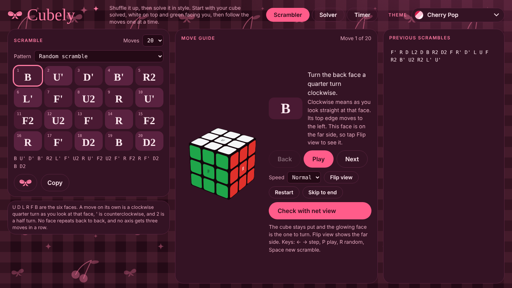
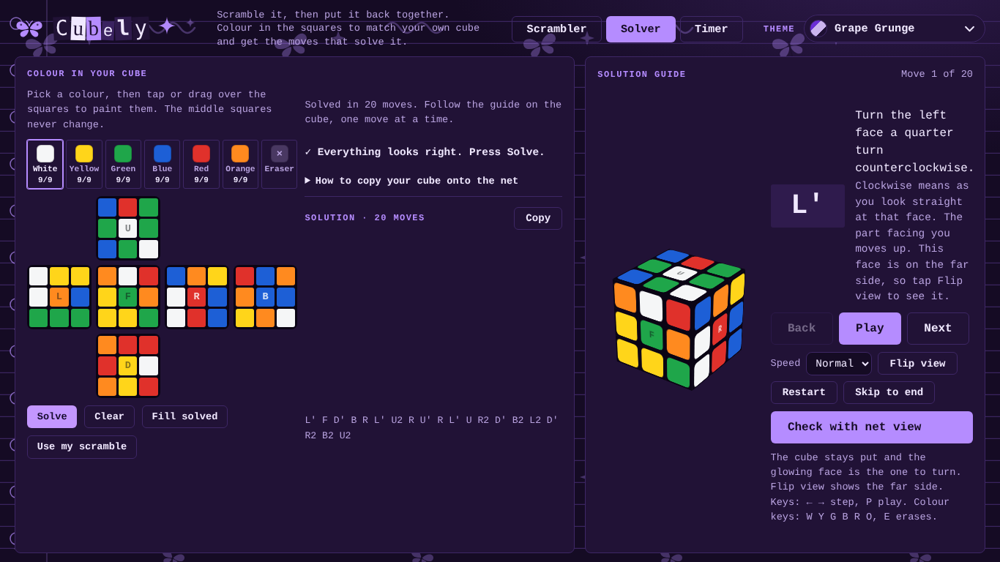
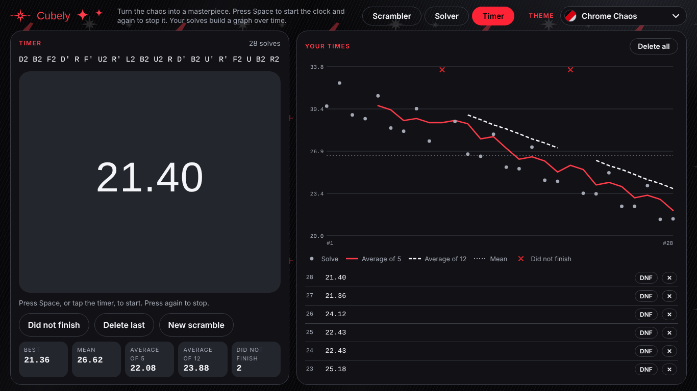
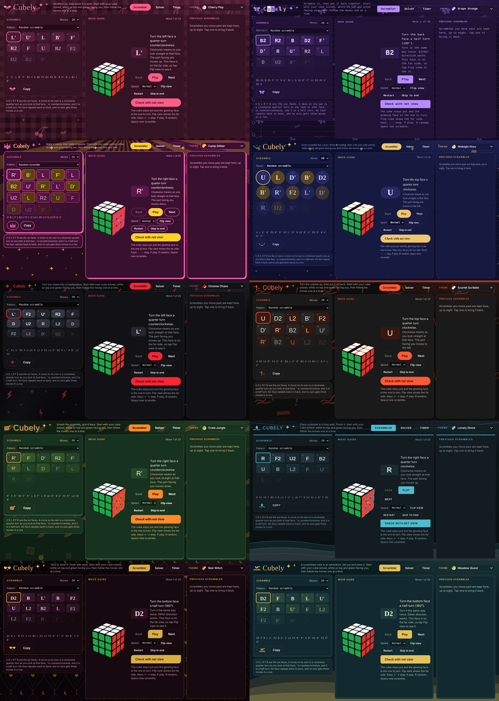

<div align="center">

# Cubely

**Scramble it. Solve it. Time it.**
A Rubik's Cube scrambler, solver and timer with ten themes, for Windows and Linux.

[**▶ Use it in your browser**](https://sunset-soda.github.io/Cubley/) · [**⬇ Download the app**](https://github.com/Sunset-Soda/Cubley/releases/latest)



</div>

## Use it online
No install needed: **https://sunset-soda.github.io/Cubley/**. It runs entirely in your browser, and your times and settings are saved in that browser.

## Download

| Platform | File | How to run |
|---|---|---|
| Windows | `Cubely-Setup-x.y.z.exe` | Double-click to install. Windows may show a SmartScreen warning because the app isn't code-signed: click **More info → Run anyway**. |
| Linux | `Cubely-x.y.z.AppImage` | `chmod +x Cubely-*.AppImage` then run it. Some distros need `libfuse2`. |

Grab them from the [Releases page](https://github.com/Sunset-Soda/Cubley/releases/latest). The app works fully offline and the theme fonts are bundled.

## What it does

### Scrambler
Generates a random scramble (or a pattern) and walks you through it with an animated 3D cube: step, play, flip to see the far side, and a net view to check your cube against. Keyboard shortcuts: `←` `→` step, `P` play, `R` random scramble, `Space` new scramble.

### Solver
Colour in a flat net of your own cube, and Cubely finds a solution and shows it on the same guide cube. While you paint it flags mistakes live (impossible pieces, duplicate pieces, wrong colour counts) and tells you what to fix.



### Timer
Press `Space` to start and stop. Every solve is saved and plotted on a graph with rolling averages of 5 and 12 and your mean. Mark any solve as DNF, delete the last one, or delete everything.



## Ten themes
Each theme has its own colours, background art, logo, fonts and light and dark versions. The app follows your system's light or dark setting.



Cherry Pop · Grape Grunge · Camp Glitter · Midnight Diary · Chrome Chaos · Scarlet Scribble · Crate Jungle · Lonely Shore · Noir Witch · Meadow Quest

*(Screenshots are taken with fallback fonts; the real app uses each theme's own typeface.)*

## Your data
Solve times, your painted cube and your chosen theme are stored locally and survive closing the app and updating.

- Windows: `%APPDATA%\Cubely`
- Linux: `~/.config/Cubely`

## Build it yourself
You need Node.js 18 or newer and an internet connection for the first build (it downloads the theme fonts).

```bash
npm install
npm start              # run without packaging
npm run dist           # Linux AppImage  -> dist/
npm run dist:win       # Windows installer -> dist/ (run on Windows)
```

Pushing a tag like `v1.1.0` makes GitHub Actions build both installers and attach them to a new release.

## Notes
- On Ubuntu 24.04 and newer, if the AppImage window doesn't open, run it with `--no-sandbox`.
- The single-file app is `index.html`; `main.js` is the small Electron wrapper.
